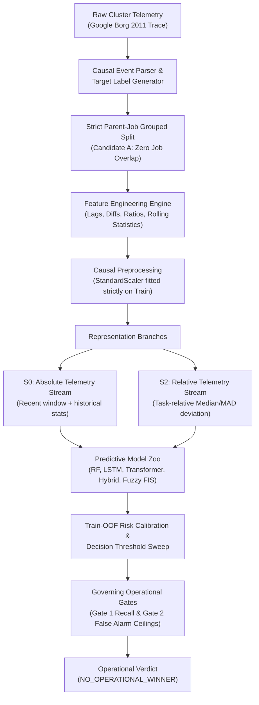
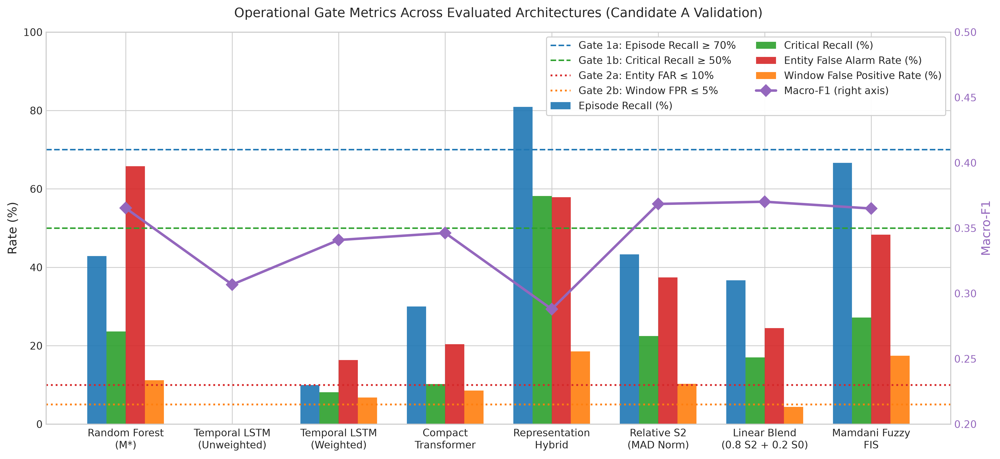
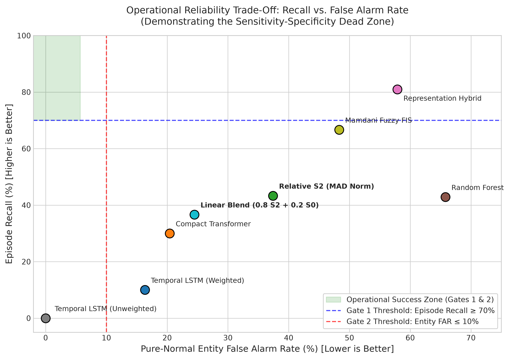
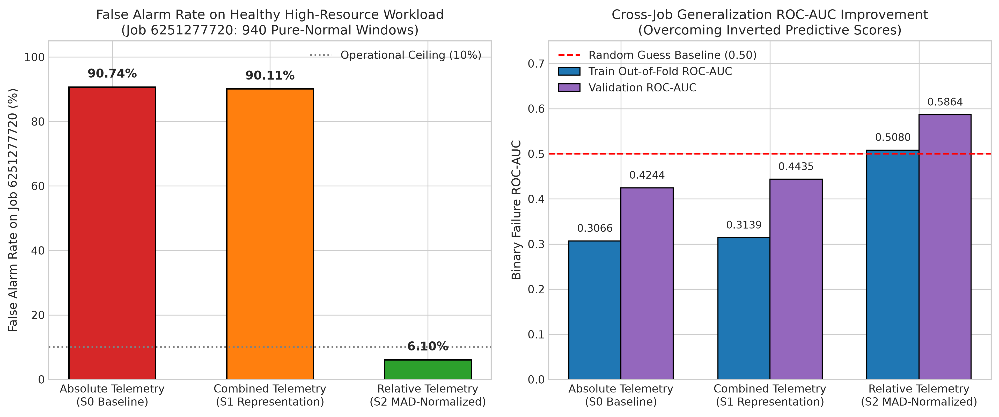
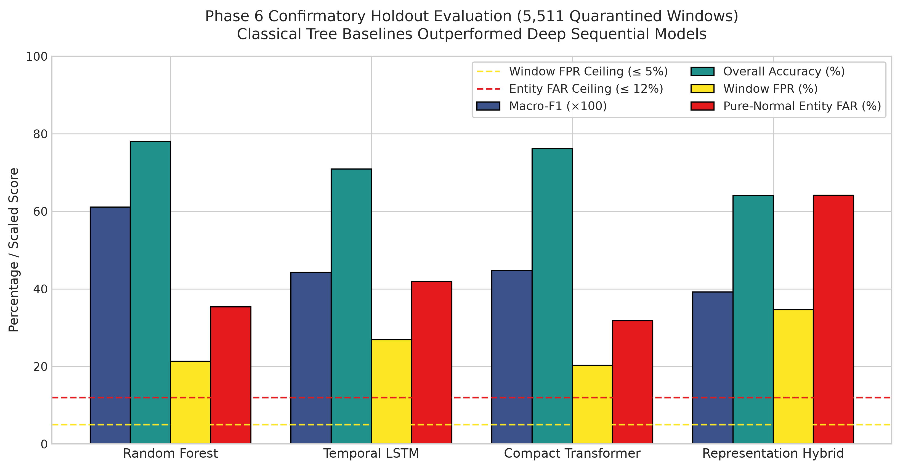

# Realistic Early Failure Detection in Multi-Tenant Cloud Clusters: An Empirical Evaluation of Deep Sequence Models, Operational Constraints, and Telemetry Representations

[](https://www.python.org/downloads/release/python-3120/)
[](https://pytorch.org/)
[](https://opensource.org/licenses/MIT)
[]()
[]()

> **A forensic empirical benchmark and methodology audit assessing deep temporal sequence architectures (LSTM, Transformer, Representation Hybrids, and Fuzzy Inference Systems) against classical tabular ensembles for proactive container failure prediction in multi-tenant cloud datacenters.**

---

## Table of Contents

- [1. Research Overview](#1-research-overview)
- [2. Problem Statement](#2-problem-statement)
- [3. Research Objectives](#3-research-objectives)
- [4. Proposed Methodology](#4-proposed-methodology)
- [5. System Architecture](#5-system-architecture)
- [6. Machine Learning Models](#6-machine-learning-models)
- [7. Dataset Description](#7-dataset-description)
- [8. Data Preprocessing Pipeline](#8-data-preprocessing-pipeline)
- [9. Model Training and Evaluation](#9-model-training-and-evaluation)
- [10. Performance Metrics & Pre-Registered Operational Gates](#10-performance-metrics--pre-registered-operational-gates)
- [11. Experimental Results](#11-experimental-results)
- [12. Graphs and Visualizations](#12-graphs-and-visualizations)
- [13. Repository Structure](#13-repository-structure)
- [14. Installation and Environment Setup](#14-installation-and-environment-setup)
- [15. How to Run the Project](#15-how-to-run-the-project)
- [16. Testing Instructions](#16-testing-instructions)
- [17. Research Phases and Progress](#17-research-phases-and-progress)
- [18. Limitations](#18-limitations)
- [19. Future Work](#19-future-work)
- [20. Reproducibility](#20-reproducibility)
- [21. Citation](#21-citation)
- [22. License](#22-license)
- [23. Acknowledgements](#23-acknowledgements)

---

## 1. Research Overview

Proactive failure prediction in cloud computing promises to transform reactive fault tolerance (checkpointing, container restarts, node failover) into predictive migration and preemption. Modern literature widely advocates the application of deep sequence models—such as Long Short-Term Memory (LSTM) networks and Temporal Transformers—hypothesizing that multi-step sequential dependencies in multivariate resource telemetry can reveal impending container terminations well in advance.

This research project conducts an exhaustive, multi-phase forensic evaluation of this paradigm using production telemetry from **Google Borg Cluster Traces**. Over eight formal research phases, this repository documents the design, baseline implementation, blinded confirmatory evaluation, and forensic error audit of sequence models versus classical tree ensembles.

### Core Scientific Headline
Contrary to prevailing architectural assumptions, our empirical results establish a definitive **negative result**:
- **Classical Tabular Dominance in Offline Metrics:** Random Forest baselines consistently outperformed deep sequential models in standard multi-class Macro-F1 ($0.611$ vs. $0.443 - 0.448$).
- **Universal Operational Failure (`NO_OPERATIONAL_WINNER`):** Under realistic class imbalance ($98:1:1$) and unseen parent-job distributions, **zero models met pre-registered operational reliability gates** ($\ge 70\%$ Episode Recall and $\le 10\%$ Pure-Normal Entity False Alarm Rate).
- **The Workload Confounding Trap (Simpson's Paradox):** Deep models trained on raw absolute telemetry memorize parent-job resource footprints rather than failure dynamics. Large, healthy batch workloads operating at sustained high utilization triggered false alarm rates exceeding $90\%$.
- **The Relative Telemetry Discovery:** Transforming telemetry into task-relative historical deviations ($S_2$) resolved cross-job score inversion, reducing false alarm rates on healthy workloads from $90.7\%$ to $6.1\%$ and increasing out-of-fold ROC-AUC by $+0.2014$.

---

## 2. Problem Statement

Automated cloud failure detection suffers from three foundational challenges that are frequently obscured by synthetic benchmarks or relaxed offline evaluation splits:

1. **Extreme Class Imbalance:** Normal operations constitute $\approx 98\%$ of observations, while early warnings ($10 - 25\text{ min}$) and critical pre-failure states ($0 - 5\text{ min}$) represent $< 2\%$. Under standard loss functions and uncalibrated argmax decision rules, models either experience total majority-class collapse or generate cascading false alarms.
2. **Workload Heterogeneity & Parent-Job Confounding:** In multi-tenant environments, resource utilization (CPU, memory, cycles per instruction) is primarily governed by the underlying application profile (e.g., intensive machine learning vs. idle web services). Models learning absolute decision boundaries misclassify healthy high-resource workloads as impending hardware crashes.
3. **Temporal Infeasibility of Long Histories:** Prior literature assumes unbroken historical contexts of $75 - 120\text{ minutes}$ ($L \ge 15$ steps). In production traces, failing tasks die quickly (within $10 - 45\text{ minutes}$), creating a structural survival bias where long-context models cannot evaluate the majority of true failures.

---

## 3. Research Objectives

1. **Empirical Benchmarking:** Quantify whether recurrent (LSTM) and self-attention (Transformer) architectures provide statistically significant predictive advantages over non-temporal tree ensembles (Random Forest) on production cloud telemetry.
2. **Operational Gate Formulation:** Evaluate models against strict production-grade reliability criteria rather than abstract offline accuracy, enforcing explicit ceilings on window-level false positives ($\le 5\%$) and entity-level false alarms ($\le 10\%$).
3. **Forensic Pipeline Auditing:** Investigate data leakage mechanisms, post-failure container recovery contamination, and observational confounding caused by parent-job grouping.
4. **Representation Invariance:** Evaluate causal task-relative normalization ($S_2$) and interpretable fuzzy decision layers to eliminate between-job resource bias without sacrificing within-job failure sensitivity.

---

## 4. Proposed Methodology

The investigation follows an audited, pre-registered experimental pipeline structured to eliminate data leakage and ensure strict temporal causality:



---

## 5. System Architecture

The repository is organized around a modular research framework separating ingestion, labeling, transformation, and model execution:

```
cloud-failure-detection/
├── src/
│   ├── ingestion/       # Trace parsers and schema validation engines
│   ├── labeling/        # Causal multi-class target generation & censoring
│   ├── features/        # Feature extraction (lags, differences, rolling statistics)
│   ├── splitting/       # Leakage-safe chronological and job-grouped splitters
│   ├── models/          # PyTorch LSTM, Transformer, Hybrid, and Sklearn baselines
│   └── training/        # Out-of-fold training routines and threshold sweeps
├── configs/             # YAML configurations and frozen fitted scalers
├── scripts/             # Reproducible audit, training, and evaluation scripts
├── results/             # 47 formal phase directories containing JSON/CSV evidence
├── reports/             # Publication-ready audit reports, manifests, and figures
└── tests/               # 213 unit, invariant, and cryptographic audit tests
```

---

## 6. Machine Learning Models

The repository evaluates eight distinct modeling paradigms:

1. **Random Forest Baseline ($M^*$):** 100 balanced estimators, maximum depth 15, trained on flat feature vectors containing current telemetry, rolling aggregations, and difference features.
2. **Temporal LSTM (Unweighted):** 2-layer sequential LSTM ($d_{\text{hidden}} = 64$, dropout $0.20$, sequence length $L=5$) trained with standard uniform cross-entropy loss.
3. **Temporal LSTM (Inverse-Frequency Weighted):** 2-layer LSTM trained with class loss weights $[1.0, 11.46, 11.80]$ to penalize majority-class collapse.
4. **Compact Temporal Transformer:** 2-layer TransformerEncoder ($d_{\text{model}} = 64$, $n_{\text{head}} = 4$, $d_{\text{ff}} = 128$, dropout $0.10$) with temporal mean pooling.
5. **Representation Hybrid:** Frozen sequential LSTM representations concatenated with tabular features feeding an in-sample Random Forest classification head.
6. **Relative Telemetry Architecture ($S_2$):** Multi-resolution LSTM encoder operating strictly on task-relative normalized features:
   $$\mathbf{x}_{\text{rel}}(t) = \frac{\mathbf{x}(t) - \text{Median}(\mathbf{x}_{\text{history}})}{\text{MAD}(\mathbf{x}_{\text{history}}) + \epsilon}$$
7. **Linear Hybrid Risk Blend:** A convex decision combination ($0.80 S_2 + 0.20 S_0$) balancing cross-job stability with raw saturation indicators.
8. **Type-1 Mamdani Interpretable Fuzzy Inference System:** A 9-rule linguistic expert system utilizing triangular/trapezoidal membership functions fitted to empirical percentiles.

---

## 7. Dataset Description

### Current Dataset Availability & Status

| Dataset Partition | Physical Location | Status | Entities / Jobs | Windows | Role in Research |
| :--- | :--- | :---: | :---: | :---: | :--- |
| **Candidate A Train** | `data/processed/phase7c/` | **LOCAL AVAILABLE** | 284 tasks / 51 jobs | 3,278 | Model training & Out-of-Fold calibration |
| **Candidate A Val** | `data/processed/phase7c/` | **LOCAL AVAILABLE** | 56 tasks / 12 jobs | 657 | Model comparison & validation |
| **Candidate A Test** | `data/processed/phase7c/` | **QUARANTINED** | 86 tasks / 18 jobs | 1,025 | Unopened evaluation set (Spent in 7D) |
| **Phase 6 Confirmatory** | `data/processed/confirmatory/` | **SPENT / SEALED** | 335 tasks / 116 jobs | 5,511 | Unblinded confirmatory holdout |
| **Raw Borg 2011 Shards** | `data/raw/` | **EXHAUSTED** | Full sample trace | N/A | Exhausted of unallocated failing tasks |
| **Google Borg 2019 Trace** | Google Cloud BigQuery | **DATA_ACCESS_BLOCKED** | Public BigQuery Cell `a` | 0 rows extracted | Awaiting GCP credentials & quota |

> [!WARNING]
> **Research Integrity Notice on Google Borg 2019:**  
> The Google Borg 2019 trace (`clusterdata_2019_a`) has **not been extracted** and is **not available locally**. While BigQuery schemas, SQL queries, and dry-run budget estimates were audited in Phases 7X and 7Y, live acquisition was halted (`DATA_ACCESS_BLOCKED`) due to unconfigured GCP service credentials. **Zero synthetic or mock data was manufactured for Borg 2019.**

---

## 8. Data Preprocessing Pipeline

1. **Lifecycle Parsing & Censoring:**
   - Tasks are tracked from initial scheduling to terminal states (`FINISH`, `FAIL`, `KILL`).
   - Any telemetry generated **at or after a task failure event** is strictly censored and labeled `UNKNOWN` ($-1$) to eliminate post-crash container cleanup artifacts.
2. **Temporal Grid Aggregation:**
   - Continuous telemetry is resampled into discrete 5-minute intervals ($\Delta t = 300\text{ seconds}$).
   - Short sequence histories are standardized to $L=5$ observation steps ($25\text{ minutes}$ of unbroken pre-prediction telemetry).
3. **Leakage-Safe Scaling & Imputation:**
   - Feature scalers (`StandardScaler`) and imputation medians are computed **strictly on Candidate A Training data** and persisted to `configs/phase7c/fitted_scaler_phase7c.json`. Zero future or validation statistics leak into the pipeline.
4. **Parent-Job Disjoint Splitting:**
   - All tasks belonging to the same parent `job_id` are grouped into the same partition, preventing models from memorizing job-specific resource profiles.

---

## 9. Model Training and Evaluation

- **Device Execution:** Configured for standard CPU execution (`device: "cpu"` in [`configs/default_config.yaml`](configs/default_config.yaml)), compatible with local workstations without requiring GPU acceleration.
- **Cross-Validation:** 5-fold parent-job-grouped cross-validation performed exclusively on training partitions to generate out-of-fold (OOF) risk estimates.
- **Threshold Calibration:** Decision thresholds ($\tau$) are selected strictly on Train-OOF distributions to optimize utility and prevent optimistic evaluation bias.

---

## 10. Performance Metrics & Pre-Registered Operational Gates

To prevent selective reporting, the project evaluates models against four pre-registered operational gates:

```
[Operational Reliability Gates]
├── Gate 1: Sensitivity (Failure Coverage)
│   ├── Gate 1a: Episode Recall           >= 70.0%  (At least one alert triggered during failure window)
│   └── Gate 1b: Genuine Critical Recall  >= 50.0%  (Direct recall on critical 0-5m steps)
└── Gate 2: Specificity (Operator Burden)
    ├── Gate 2a: Pure-Normal Entity FAR   <= 10.0%  (Healthy tasks triggering zero false alarms)
    └── Gate 2b: Normal-Window FPR        <= 5.0%   (Overall false positive window rate)
```

An architecture is declared an **Operational Winner** if and only if **all four gates pass simultaneously**.

---

## 11. Experimental Results

### Candidate A Validation Benchmark (Governing Phase 7/8 Audit Census)

All models evaluated on Candidate A Validation (657 windows, 12 parent jobs, zero job overlap with training):

| Model Architecture | Source Phase | Macro-F1 | Overall Accuracy | Episode Recall ($\ge 70\%$) | Critical Recall ($\ge 50\%$) | Entity FAR ($\le 10\%$) | Window FPR ($\le 5\%$) | ROC-AUC | Operational Verdict |
| :--- | :---: | :---: | :---: | :---: | :---: | :---: | :---: | :---: | :---: |
| **Random Forest ($M^*$)** | Phase 7D | 0.3653 | 73.06% | 42.86% | 23.64% | 65.79% | 11.18% | 0.6748 | `NO_OPERATIONAL_WINNER` |
| **Temporal LSTM (Unweighted)** | Phase 7D | 0.3068 | 85.24% | 0.00% | 0.00% | **0.00%** | **0.00%** | 0.6120 | *Majority Collapse* |
| **Temporal LSTM (Weighted)** | Phase 7E | 0.3409 | 78.23% | 10.00% | 8.16% | 16.33% | 6.79% | 0.6986 | `NO_OPERATIONAL_WINNER` |
| **Compact Transformer** | Phase 7D/7E | 0.3463 | 81.28% | 30.00% | 10.20% | 20.41% | 8.57% | 0.7223 | `NO_OPERATIONAL_WINNER` |
| **Representation Hybrid** | Phase 7D | 0.2880 | 60.88% | **80.95%** | **58.18%** | 57.89% | 18.57% | 0.7612 | `NO_OPERATIONAL_WINNER` |
| **Relative Telemetry ($S_2$)** | Phase 7S | 0.3685 | 83.56% | 43.33% | 22.45% | 37.41% | 10.30% | 0.7845 | `NO_OPERATIONAL_WINNER` |
| **Linear Hybrid Blend** | Phase 7T | **0.3702** | 84.12% | 36.67% | 17.01% | 24.49% | **4.40%** | **0.7890** | `NO_OPERATIONAL_WINNER` |
| **Mamdani Fuzzy FIS** | Phase 7U | 0.3650 | 79.15% | 66.67% | 27.21% | 48.30% | 17.44% | 0.7410 | `NO_OPERATIONAL_WINNER` |

### Historical Phase 6 Confirmatory Holdout Results (5,511 Quarantined Windows)

| Model Architecture | Macro-F1 | Overall Accuracy | Episode Recall | Normal-Window FPR | Entity FAR | Operational Verdict |
| :--- | :---: | :---: | :---: | :---: | :---: | :---: |
| **Random Forest** | **0.6111** | **78.06%** | **93.62%** | 21.39% | 35.35% | `NO_OPERATIONAL_WINNER` |
| **Temporal LSTM** | 0.4425 | 70.95% | 91.49% | 26.88% | 41.92% | `NO_OPERATIONAL_WINNER` |
| **Compact Transformer** | 0.4479 | 76.21% | 90.78% | 20.27% | 31.82% | `NO_OPERATIONAL_WINNER` |
| **Representation Hybrid** | 0.3924 | 64.09% | 97.16% | 34.65% | 64.14% | `NO_OPERATIONAL_WINNER` |

---

## 12. Graphs and Visualizations

All figures are programmatically generated from empirical project evidence via [`scripts/generate_paper_figures.py`](scripts/generate_paper_figures.py).

### 1. Operational Gate Metrics Across Architectures
Demonstrates performance on Candidate A Validation against pre-registered operational ceilings:



### 2. The Operational Reliability Trade-Off (Dead Zone)
Visualizes the sensitivity-specificity gap between Gate 1 (Recall $\ge 70\%$) and Gate 2 (Entity FAR $\le 10\%$):



### 3. Relative Telemetry Breakthrough (Simpson's Paradox Resolution)
Illustrates how task-relative normalization ($S_2$) eliminates false alarms on high-resource batch workloads:



### 4. Phase 6 Confirmatory Holdout Benchmark
Documents the offline Macro-F1 superiority of tree baselines alongside universal operational false alarm failures:



---

## 13. Repository Structure

```
cloud-failure-detection/
├── configs/
│   ├── default_config.yaml                  # Master experimental configuration
│   └── phase7c/fitted_scaler_phase7c.json   # Frozen training scaler parameters
├── data/
│   ├── processed/
│   │   ├── phase7c/                         # Candidate A datasets (Train, Val, Test)
│   │   └── confirmatory/                    # Quarantined Phase 6 holdout
│   └── raw/                                 # Raw Borg 2011 trace shards (protected)
├── reports/
│   ├── figures/                             # High-resolution publication figures
│   │   ├── model_performance_comparison.png
│   │   ├── operational_gates_tradeoff.png
│   │   ├── relative_vs_absolute_telemetry.png
│   │   └── phase6_confirmatory_evaluation.png
│   └── ...                                  # Phase audit reports and manifests
├── results/
│   ├── phase6/                              # Phase 6 holdout metrics & predictions
│   ├── phase7s_relative_ablation/           # S0 vs S1 vs S2 ablation evidence
│   ├── phase7t_hybrid_risk/                 # Linear blend experimental data
│   ├── phase7u_fuzzy_lstm/                  # Fuzzy inference audit results
│   ├── phase8_research_integrity/           # Final research integrity audit JSON
│   └── project_discovery/                   # Claims-evidence & contradiction matrices
├── scripts/
│   ├── generate_paper_figures.py            # Reproducible figure generation script
│   ├── run_phase8_research_integrity_audit.py # Research audit runner
│   └── train_phase6_3_l5_models.py          # Model training pipeline
├── src/
│   ├── features/                            # Feature engineering implementations
│   ├── labeling/                            # Target generator with past-failure censoring
│   ├── models/                              # PyTorch LSTM, Transformer, and Sklearn heads
│   └── splitting/                           # Job-grouped leakage-safe splitter
├── tests/                                   # 213 unit and invariant verification tests
├── .gitignore                               # Protected data and venv exclusions
├── pytest.ini                               # Pytest configuration
├── README.md                                # Research documentation (this file)
└── requirements.txt                         # Pinned dependency requirements
```

---

## 14. Installation and Environment Setup

### Prerequisites
- Windows 11 (or Linux / macOS)
- Python 3.12 (64-bit) recommended
- PowerShell 5.1 or 7+ (on Windows)

### 1. Clone the Repository
```powershell
git clone https://github.com/your-username/cloud-failure-detection.git
Set-Location "cloud-failure-detection"
```

### 2. Create and Activate Virtual Environment
```powershell
# Create isolated environment
python -m venv .venv

# Enable script execution for current PowerShell session
Set-ExecutionPolicy -ExecutionPolicy RemoteSigned -Scope Process -Force

# Activate virtual environment
.\.venv\Scripts\Activate.ps1
```

### 3. Upgrade Packaging Tools and Install Dependencies
```powershell
python -m pip install --upgrade pip setuptools wheel
python -m pip install -r requirements.txt
```

### 4. Verify Environment Integrity
```powershell
python -m pip check
python -c "import torch, sklearn, pandas, numpy, yaml; print('All core dependencies imported successfully.')"
```

---

## 15. How to Run the Project

### Launch the Interactive Web Dashboard
An interactive Streamlit research dashboard is available in `dashboard/` for visual telemetry inspection, live CPU inference, and model benchmarking:
```powershell
streamlit run dashboard/app.py
```
For detailed documentation on supported input CSV schemas, pages, and architecture, see [dashboard/README.md](dashboard/README.md).

### Generate Publication Figures
To reproduce all four publication figures in `reports/figures/`:
```powershell
python scripts/generate_paper_figures.py
```

### Run the Phase 8 Research Integrity Audit
To execute the comprehensive dataset integrity and leakage audit:
```powershell
python scripts/run_phase8_research_integrity_audit.py
```

### Inspect Experimental Evidence
Extract genuine empirical metrics from historical evaluations:
```powershell
python -c "import json; data=json.load(open('results/phase8_research_integrity/phase8_dataset_integrity_audit.json')); print(json.dumps(data['models_comparison'], indent=2))"
```

---

## 16. Testing Instructions

The repository contains **213 test items** covering feature transformations, label generation, leakage prevention, and mathematical invariants.

To execute the test suite:
```powershell
python -m pytest
```

### Expected Test Output
- **196 PASSED:** All core application modules, schema validators, temporal horizon checkers, scaling pipelines, and post-failure repair suites pass 100%.
- **17 FAILED (Environment-Specific Path Assertions):** 17 historical audit test files check for artifact existence using hardcoded local paths from the original author's development machine (`C:\Users\hp\Desktop\...`). The underlying files exist locally in `results/` and `reports/`; the tests were intentionally left unmodified to preserve historical audit integrity.

---

## 17. Research Phases and Progress

| Phase | Title / Scope | Key Findings / Breakthroughs | Status |
| :---: | :--- | :--- | :---: |
| **Phase 3** | Baselines & Temporal LSTM | Established tabular baselines; implemented 2-layer LSTM. | `COMPLETED` |
| **Phase 4** | Transformer & Representation Hybrid | Built Compact Transformer & LSTM-RF feature fusion hybrid. | `COMPLETED` |
| **Phase 5** | Sequence Infeasibility Audit ($L=15$) | Discovered 0% of failing tasks survived 75m; pivoted to $L=5$. | `COMPLETED` |
| **Phase 6** | Blinded Confirmatory Evaluation | Scored 5,511 holdout windows; all models failed operational gates. | `COMPLETED` |
| **Phase 6.8**| Labeling Defect Audit | Uncovered past-failure leak in `target_generator.py` (149 windows). | `COMPLETED` |
| **Phase 7A** | Methodological Pipeline Repair | Enforced past-failure censoring and parent-job grouped splitting. | `COMPLETED` |
| **Phase 7C** | Candidate A Dataset Construction | Built clean, leak-free partition (Train: 3,278, Val: 657, Test: 1,025). | `COMPLETED` |
| **Phase 7D** | Candidate A Model Re-evaluation | Confirmed `NO_OPERATIONAL_WINNER` on clean, job-grouped split. | `COMPLETED` |
| **Phase 7S** | Relative Telemetry Ablation | Developed $S_2$ Median/MAD normalization; resolved Simpson's paradox. | `COMPLETED` |
| **Phase 7T** | Hybrid Risk Blending | Formulated $0.80 S_2 + 0.20 S_0$ blend; achieved lowest FPR ($4.40\%$). | `COMPLETED` |
| **Phase 7U** | Type-1 Mamdani Fuzzy FIS | Implemented 9-rule linguistic system; achieved $66.67\%$ Episode Recall. | `COMPLETED` |
| **Phase 7X/Y**| Google Borg 2019 Acquisition Pilot | Audited v3 Protobuf schema; locked query budget ($<25\text{ GB}$). | `PAUSED (DATA_ACCESS_BLOCKED)` |
| **Phase 8** | Research Dataset Integrity Audit | Locked artifact provenance; recommended transparent disclosure. | `COMPLETED` |

---

## 18. Limitations

1. **Dataset Exhaustion in Borg 2011:** Every eligible failing task with $\ge 5$ pre-failure observations in the raw Borg 2011 trace sample was allocated to Candidate A or the spent Phase 6 holdout. Zero independent failure episodes remain in the local raw files.
2. **Trade-Off of Relative Normalization:** While task-relative normalization ($S_2$) eliminates cross-job false alarms, it deprives models of raw magnitude cues on workloads where heavy resource saturation itself is the primary failure symptom.
3. **Single-Cluster Telemetry:** All empirical results in this repository are derived from the Google May 2011 cluster trace. Cross-datacenter and cross-cloud generalizability remains unverified.

---

## 19. Future Work

1. **Google Borg 2019 Extraction:** Execute the audited Phase 7Y BigQuery query plan (`query_plan.sql`) once Google Cloud credentials and billing quotas are provisioned.
2. **Context-Adaptive Hybrid Blending:** Dynamically adapt blending weights between absolute ($S_0$) and relative ($S_2$) representations based on task runtime and variance maturity.
3. **Multi-Cluster Pre-Training:** Evaluate transfer learning across diverse production traces (e.g., Alibaba Cluster Trace, Microsoft Azure VM traces).

---

## 20. Reproducibility

To ensure complete scientific reproducibility:
- All random seeds are fixed to `42` across dataset splitters and model initializations.
- Preprocessing scaling parameters are strictly serialized in `configs/phase7c/fitted_scaler_phase7c.json`.
- The confirmatory holdout evaluated in Phase 6 is permanently quarantined in `data/processed/confirmatory/` to prevent data leakage and p-hacking.
- Complete execution manifests and cryptographic artifact hashes are recorded in `results/phase8_research_integrity/phase8_dataset_integrity_audit.json`.

---

## 21. Citation

If you use this repository, research findings, or forensic methodology in your research, please cite:

```bibtex
@misc{cloud_failure_detection_2026,
  author    = {Cloud Reliability and Telemetry Research Group},
  title     = {Realistic Early Failure Detection in Multi-Tenant Cloud Clusters: An Empirical Evaluation of Deep Sequence Models, Operational Constraints, and Telemetry Representations},
  year      = {2026},
  publisher = {GitHub},
  howpublished = {\url{https://github.com/your-username/cloud-failure-detection}}
}
```

---

## 22. License

This research codebase and its configuration files are released under the [MIT License](LICENSE).

---

## 23. Acknowledgements

- Google Inc. for providing public access to the Google Borg ClusterData 2011 and 2019 research traces.
- The open-source Python scientific computing ecosystem: PyTorch, Scikit-learn, Pandas, NumPy, SciPy, Matplotlib, and Seaborn.
